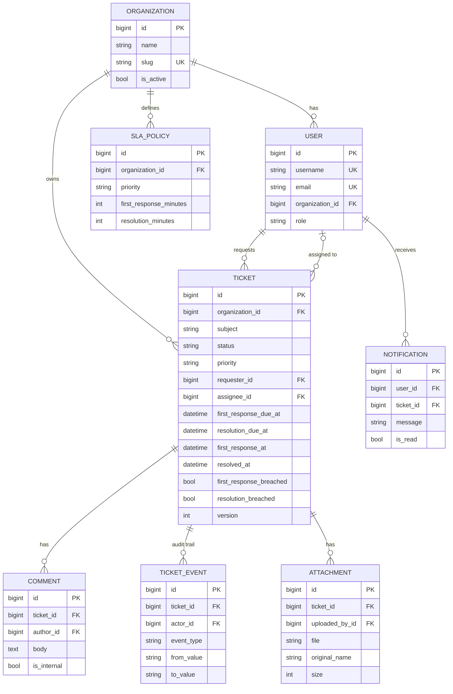

# Architecture & Design

## 1. Requirements (SRS summary)

**Functional**
- FR1 Organizations onboard themselves; each has isolated data.
- FR2 Users authenticate with JWT; roles control what they can do.
- FR3 Customers raise tickets; staff triage, assign, reply, resolve; customers can close/reopen.
- FR4 SLA targets per priority; the system detects and records breaches automatically.
- FR5 Live updates, in-app and email notifications, full audit trail, attachments, dashboards.

**Non-functional**
- Security: tenant isolation, least privilege, hashed passwords, validated uploads, throttling, private files.
- Reliability: idempotent background jobs, retries, transactions, no lost updates.
- Performance: indexes for all hot filters, `select_related`, pagination, cached dashboards.
- Operability: health check, logs, containerised, CI.

## 2. High-level design

```
 Browser / Mobile / API client
        │  HTTPS (REST + JWT)          │  WSS (JWT in query string)
        ▼                              ▼
 ┌──────────────────────────  ASGI server (Daphne)  ─────────────────────────┐
 │  Django + DRF  (views → serializers → services → ORM)   Channels consumers│
 └───────┬─────────────────────────────┬──────────────────────┬──────────────┘
         │ SQL                         │ cache / pub-sub       │ enqueue
         ▼                             ▼                       ▼
      MySQL 8                        Redis  ◄────────────  Celery workers ◄── Celery Beat (every minute)
   (source of truth)        (cache, channel layer, broker)   (emails, SLA scan, auto-close)
```

## 3. Layering (why the code is organised this way)

| Layer | Responsibility | Rule |
|---|---|---|
| View (`views.py`) | HTTP only: parse, authorise, call service, serialise | No business rules |
| Serializer | Shape + field validation | No side effects |
| **Service** (`services.py`) | Business rules, state machine, transactions, events | Single place for rules, easy to unit test |
| Model | Data + constraints + indexes | Constraints enforce invariants in the DB |
| Tasks | Thin Celery wrappers | Lazy imports avoid import cycles |

SOLID in practice: **S**: each module has one job. **O**: new status or SLA rule = data/dict change, not view edits.
**D**: views depend on service functions, not on ORM details.
Patterns used: Service Layer, State Machine, Mixin (tenant scoping), Factory (permission classes), Observer
(broadcast via channel groups), Outbox-lite (`transaction.on_commit` side effects), Optimistic Locking.

## 4. ER diagram



Key constraints and indexes: `UNIQUE(sla_policy.organization, priority)`; composite indexes
`(organization, status)`, `(organization, assignee)`, `(organization, created_at)` for the list screens;
`(first_response_breached, first_response_due_at)` and `(resolution_breached, resolution_due_at)` for the SLA scanner;
`(user, is_read)` for the notification badge.

## 5. Ticket state machine

```
OPEN ──► IN_PROGRESS ──► RESOLVED ──► CLOSED (final)
 │  ▲        │  ▲            │
 │  │        ▼  │            └──► OPEN (reopen)
 │  └── WAITING_CUSTOMER ──► RESOLVED
 └──────────────────────────────► CLOSED (cancel)
```
Customers may only: OPEN→CLOSED (cancel), RESOLVED→CLOSED (accept), RESOLVED→OPEN (reopen).
A customer reply on a WAITING_CUSTOMER ticket automatically moves it to IN_PROGRESS.

## 6. Authorization model (3 layers)

1. **Endpoint**: `roles_allowed(...)` permission classes (e.g. reports = manager/org_admin).
2. **Data**: `TenantScopedMixin` filters by organization; customers are additionally limited to `requester=self`.
3. **Business rule**: services decide e.g. "agents may only claim unassigned tickets for themselves".

Cross-tenant IDs return **404, not 403**, so attackers can't even learn that an ID exists.

## 7. Key design decisions

| Decision | Reason | Trade-off |
|---|---|---|
| Row-level multi-tenancy (shared DB + `organization` FK) | Simple, cheap, scales to thousands of tenants | Every query must be scoped (mitigated by a mixin + tests); schema-per-tenant gives stronger isolation |
| One organization per user | Simpler auth and claims | Real tools use a Membership table for multi-org users |
| Service layer | Rules testable without HTTP | Slightly more files |
| Optimistic locking (`version`) | No DB locks held while a human thinks; detects lost updates | Client must handle 409 |
| Side effects in `transaction.on_commit` | Never email/broadcast about data that later rolls back | Not durable if the process dies between commit and enqueue (a true outbox table fixes this) |
| Two WebSocket groups per ticket | Internal notes can never reach customers | Two `group_send` calls per public event |
| Reports averaged in Python (latest 1000 rows) | Portable across MySQL/SQLite | At scale use a pre-aggregated stats table |
| JWT in WebSocket query string | Browsers can't set WS headers | Token can appear in server logs; use short-lived tokens or a ticket-exchange endpoint in production |
| Files streamed through an authorised view | Storage is never publicly addressable | Uses app bandwidth; in AWS use S3 presigned URLs |

## 8. Scalability & performance notes

- Stateless app servers: scale horizontally behind a load balancer; Redis channel layer fans out WebSocket events across instances.
- DB: composite indexes, `select_related` on lists, pagination everywhere, short `CONN_MAX_AGE`; add a read replica for reports.
- Background work is off the request path; SLA scan uses indexed range queries and per-ticket idempotent updates.
- Cache the dashboard (60 s); invalidate by TTL.
- Next: Celery queues per task type, partition `ticket_event` by date, OpenSearch for full-text search.

## 9. Security checklist (implemented)

Hashed passwords + validators, JWT with short access / rotating refresh + blacklist on logout, per-scope throttling,
tenant scoping everywhere, role checks, upload allow-list + size cap + private storage + UUID filenames,
no stack traces in API errors, production settings (HTTPS redirect, secure cookies, HSTS), secrets only from environment,
non-root Docker user, immutable audit trail.
